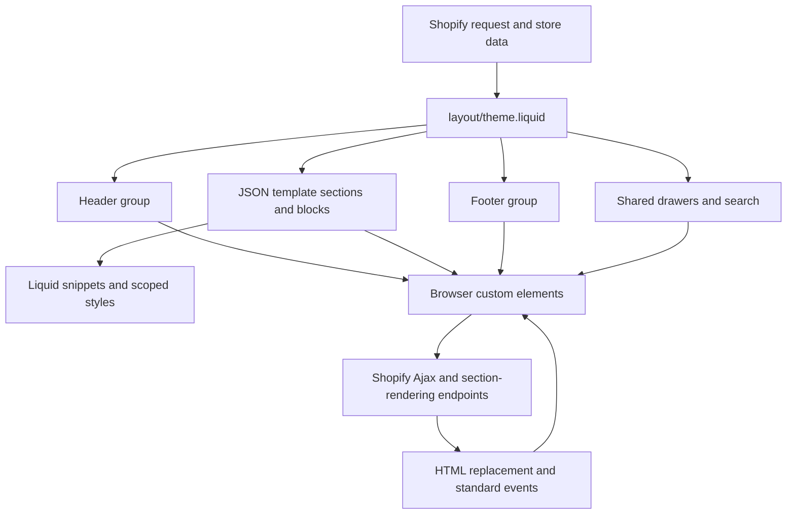

# Favrik architecture and cleanup guide

Source audit: 13 November 2026. This describes the local working tree, including uncommitted work, rather than asserting what is deployed to the live store.

This file is explicitly excluded in `.shopifyignore`, in addition to the existing `*.md` exclusion. Keep it at the repository root. Shopify CLI respects these exclusions for theme operations; a different deployment tool or direct API uploader must have its own exclusion rules. No theme push, publication, or store mutation was performed for this audit.

## 1. Recommended approach

Preserve the current appearance and buying journey. Make small, reversible changes with a concrete reason, then compare against a baseline. Separate maintenance improvements from changes that demonstrably improve loading or interaction speed.

Start with redundant resource hints and verified unnecessary loading. Fix noisy lint findings in a separate small change. Leave CSS restructuring, cart logic, image processing, and carousel rewrites until the initial pass has been checked in a browser.

The user requested a plan before storefront changes and then authorized the initial batch. The roadmap below distinguishes proposals from the completed work recorded in section 11.

### Proposed first batch

1. **Deduplicate identical configured-font preloads.** `snippets/fonts.liquid` currently preloads four font roles. Heading and accent both use `inter_n7`, so they produce the same hint. Preserve every distinct font URL and all font declarations, weights, and fallbacks. This reduces redundant HTML/hints; browsers may already coalesce the requests, so do not claim a measurable speed increase from this alone.
2. **Remove preload priority from the overridden body font, only after verifying actual use.** Body text uses Poppins, while the body setting still points to Inter. Determine whether that specific configured Inter face is needed above the fold through another role before removing its preload. Preserve its `@font-face` declaration so normal demand loading still works. This is a candidate for reducing competition with visible text/images, not an unconditional deletion.
3. **Fix the password stylesheet comment.** A literal Liquid stylesheet tag inside a CSS comment produces two theme-check errors. Reword only the comment. This is maintenance with no expected visual or speed effect.

Stop that batch if font use cannot be verified. Do not add speculative script restrictions just to make the diff larger. Global scripts can support the cart drawer, search, asynchronously inserted product cards, quick add, and editor sections on pages whose main template does not contain those features.

### First-pass exclusions

- Keep the existing Meta/Instagram navigation safeguards in `view-transitions.js`. Both transition settings are false, but `base.css` contains a cross-document transition opt-in, so the settings alone do not establish that this script is redundant.
- Keep product forms, variant changes, cart events, checkout, prices, pickup/preorder behavior, and carousel physics intact.
- Keep the current font families and weights, image crop, spacing, colors, and layout intact.
- Do not remove a file just because it is absent from a JSON template: several sections are HTTP rendering endpoints.

## 2. Platform and ownership

This is a customized Shopify **Horizon 4.1.1** Liquid theme, as declared in `config/settings_schema.json`. It has no separate application server or frontend build pipeline declared in `package.json`. The package file contains Shopify CLI/theme development dependencies and no project test/build scripts.

Shopify supplies products, collections, inventory, variants, page content, translations, menus, customer/contact forms, predictive search, cart endpoints, recommendations, and checkout. Theme files supply presentation and browser interactions. Admin data definitions and live app configuration cannot be established completely from this checkout.

| Layer | Responsibility | Main entry points |
| --- | --- | --- |
| Layouts | Document shell, global assets, groups, overlays | `layout/theme.liquid`, `layout/password.liquid` |
| Templates | Section order and saved block/section settings | `templates/*.json`; standalone `templates/gift_card.liquid` |
| Section groups | Shared header/footer composition | `sections/header-group.json`, `sections/footer-group.json` |
| Sections | Feature markup, schema, section CSS/JS | `sections/*.liquid` |
| Blocks | Merchant-editable nested components | `blocks/*.liquid`; `content_for` renders children |
| Snippets | Shared Liquid markup, calculations, style helpers | `snippets/*.liquid`; `render` passes explicit arguments |
| Assets | Browser modules, global CSS, images/icons | `assets/` |
| Settings | Available controls versus saved values | `config/settings_schema.json`, `config/settings_data.json` |
| Locales | Storefront and editor translations | `locales/` |

Audit inventory: 2 layouts, 18 templates, 36 sections, 64 blocks, 138 snippets, 131 assets, and 51 locale files. Counts describe the current checkout, not usage or dead-code status.

## 3. Current page composition

Template assignments to individual Shopify pages are store data. The following is the local template wiring, not proof that every route is published.

| Page/template | Sections in saved order | Special behavior |
| --- | --- | --- |
| Home: `index.json` | `collection-list`, `product-list`, `category-hero-grid`, `product-list`, disabled `product-list`, `shop-social` | Hero, New Arrivals/Signature and Best Sellers rows, categories, social looks; FW2026 row is disabled |
| Collection: `collection.json` | `collection-header`, `main-collection` | Filters, sorting, paginated product grid |
| Collection index: `list-collections.json` | `main-collection-list` | Collection cards |
| Product: `product.json` | `product-information`, `product-recommendations` | Gallery, details, variants, purchase controls, accordions, recommendations |
| Cart: `cart.json` | `main-cart`, `product-list` | Cart page plus merchandising row |
| Search: `search.json` | `search-header`, `search-results` | Search input, filters, results grid |
| Default page: `page.json` | `main-page`, `policy-page`, `shop-insta-gallery` | Runtime handle checks decide which content actually renders |
| About: `page.about.json` | `about-page` | Custom video/content page |
| Contact: `page.contact.json` | `contact-page` | Native contact form and desktop video |
| Locations: `page.locations.json` | `locations-page` | Two store panels and maps |
| Privacy/terms alternates | `policy-page` | Shared layout and separate copy snippets |
| Returns: `page.returns-policy.json` | `returns-policy-page` | Dedicated policy section |
| Blog/article | `main-blog` / `main-blog-post` | Editorial cards, article content and supporting blocks |
| 404: `404.json` | `main-404` | Custom recovery content |
| Password: `password.json` | `password` | Separate password layout and password footer |
| Gift card | `gift_card.liquid` | Standalone template with gift-card CSS and QR-related assets |

The global footer group is `colorway-rectangles` → `favrik-footer` → `email-marketing-popup`. The global header group contains `header`.

## 4. Shared browser architecture

### Asset loading and custom elements

`snippets/scripts.liquid` defines an import map for `@theme/*` modules and Shopify's hosted `@shopify/events`. It emits global module scripts and preloads, with some conditional loading for homepage scripts, collection facets, quick add, localization, and product sticky add-to-cart/recent history. Other features emit script tags from their own Liquid files.

`assets/component.js` provides component lifecycle, `ref` lookup, observation, and delegated `on:click`/`on:change` style handlers. HTML attributes, ref names, and custom-element tag names are interfaces. Renaming them requires checking both Liquid and JavaScript.

`assets/utilities.js`, `focus.js`, `dialog.js`, `theme-drawer.js`, and `scrolling.js` provide shared behavior. Some features are plain document-level scripts rather than subclasses of `Component`; lifecycle handling therefore varies.

### Events and rendering

- `assets/events.js`: local events, including quantity changes, media playback, slideshow selection, zoom, and menu hover.
- `@shopify/events`: standard product/cart/search/collection events, often carrying a promise for the completed request.
- `assets/standard-actions-override.js`: configures Shopify actions to update/open the theme cart drawer, with a cart-page fallback.
- `assets/section-renderer.js`: section HTML fetching, cache, pending requests, abort controllers, and DOM morphing.
- `assets/morph.js`: preserves/replaces parts of existing DOM when fresh HTML arrives.
- `assets/section-hydration.js`: idle hydration targeting `data-hydration-key`; used by the header.

Preserve request cancellation and event-promise contracts. A cart drawer opening before a product/modal operation finishes can cause visible stale content or overlapping dialogs.

## 5. Major features

### 5.1 Header, navigation, logo, and announcement strip

Owners: `sections/header.liquid`, `blocks/_header-logo.liquid`, `blocks/_header-menu.liquid`, `snippets/header-row.liquid`, `snippets/header-actions.liquid`, and `assets/header.js`, `header-menu.js`, `header-actions.js`, `overflow-list.js`.

The header manages transparent/sticky states, menu sizing, search, account/cart actions, and localization. The logo has an asset fallback. `snippets/product-delivery-banner.liquid` supplies the top promotion/free-delivery strip despite its product-specific filename. Its messages crossfade with CSS; header behavior controls how the strip relates to scrolling.

The layout contains early inline header measurements to establish CSS variables before the module code runs. Equivalent calculations exist in `utilities.js`. This duplication is intentional to prevent layout shift; removing it needs first-paint comparison.

### 5.2 Catalog navigation and overlay coordination

Owners: `snippets/catalog-nav-drawer.liquid`, `assets/catalog-nav-drawer.js`, `snippets/theme-drawer.liquid`, `snippets/theme-drawer-styles.liquid`, `assets/theme-drawer.js`, `assets/focus.js`.

Catalog navigation positions itself relative to the header, tracks resize/scroll while open, and coordinates with header search through `catalog-nav:open` and `header-sku-search:open`. Shared drawers handle focus, opening/closing, responsive behavior, and scroll locking. CSS breakpoints and the `.page-wrapper` scroll container participate in this behavior.

### 5.3 Header and filter SKU/name autocomplete

Owners: `snippets/header-sku-search.liquid`, `assets/header-sku-search.js`, `assets/sku-search.js`, `sections/sku-search-results.liquid`, `snippets/sku-search-product-data.liquid`, `snippets/search-autocomplete-styles.liquid`, and search markup in `blocks/filters.liquid`.

Flow: type → 180ms debounce → predictive-search request with `section_id=sku-search-results` → HTML containing JSON → client rendering of up to eight matches. A 417 response falls back to the normal search endpoint. A bounded in-memory cache stores up to 50 query results. Abort controllers and version checks prevent stale results replacing newer input.

The JSON carries title, image, formatted display price, URL, and title/SKU terms. Keyboard navigation, active-option ARIA, mobile keyboard handling, errors/loading/empty states, and a full-results link are part of the feature. Server result order is retained; match scoring helps select display terms rather than sorting the results.

### 5.4 Standard search modal and full search page

Owners: `snippets/search-modal.liquid`, `snippets/search.liquid`, `assets/predictive-search.js`, `sections/predictive-search.liquid`, `sections/predictive-search-empty.liquid`, `sections/search-header.liquid`, `sections/search-results.liquid`, `assets/search-page-input.js`.

This retained Horizon search path is separate from the custom SKU interface. It supports predictive resources and recently viewed products. The full results page uses Shopify search results, filters, pagination, and shared product cards. Do not assume the older path is unused because the visible header uses the custom path; check all triggers and settings first.

### 5.5 Homepage hero and video

Owners: `sections/collection-list.liquid`, `snippets/collection-card.liquid`, `blocks/_collection-card-image.liquid`, `snippets/resource-image.liquid`, `snippets/hero-video.liquid`, `assets/homepage-hero.js`, and the poster JPEG assets.

The homepage hero is implemented through collection showcase components rather than a standalone `hero.liquid`. The image block contains a homepage video URL fallback. `hero-video` renders an eager high-priority poster and reveals video after a decoded frame is available. About uses the same component with a different poster and reveal threshold. Mobile hero code retains the initial panel height when only browser toolbar height changes.

Keep poster dimensions and first-frame reveal behavior when optimizing media. Black/blank flashes and hero height changes directly affect perceived speed.

### 5.6 Homepage product rows, randomization, and carousel movement

Owners: `sections/product-list.liquid`, `snippets/resource-list*.liquid`, `snippets/slideshow*.liquid`, `assets/slideshow.js`, `assets/random-collection-images.js`, `assets/carousel-edge-pan.js`.

Selected homepage carousel rows can render up to 50 candidate products and show a random subset. An inline pre-paint shuffle avoids a later row-height change; the external script supports initialization of later/editor content. New Arrivals/Signature and Best Sellers behavior is partly selected through heading strings; FW2026 uses a collection handle.

Desktop rows add free drag, edge-hover panning, and card settling. Mobile has separate swipe behavior. Visible card count is not the same as generated HTML count. Reducing candidate markup may help, but must preserve random selection, editor settings, image loading, and carousel geometry.

### 5.7 Homepage section navigation

Owners: `snippets/homepage-section-nav.liquid`, `assets/homepage-section-nav.js`, and `data-homepage-section` markers in the sections.

Navigation ticks locate section wrappers, remove missing targets, compute header offsets, scroll the correct container, and update the active section with one scheduled animation frame per burst of scroll events. This supports both window scrolling and `.page-wrapper` scrolling. Section keys are a shared contract with product rows and categories.

### 5.8 Category hero grid

Owners: `sections/category-hero-grid.liquid`, `assets/category-hero-grid.js`.

Four category panels use shop metafield images and section settings. Links resolve through explicit overrides, configured/fallback collections, and product-type URLs. Product-type matching normalizes styled Unicode letters. This is compatibility logic for catalog naming, not automatically disposable duplication.

### 5.9 Collection grid, filters, sorting, and pagination

Owners: `sections/collection-header.liquid`, `sections/main-collection.liquid`, `blocks/filters.liquid`, `snippets/list-filter.liquid`, `price-filter.liquid`, `sorting.liquid`, `product-grid.liquid`, and `assets/facets.js`, `paginated-list.js`, `paginated-list-aspect-ratio.js`, `collection-header-filters.js`.

Shopify supplies filter values and product results. Filter changes update the URL and request section HTML; morphing updates the page, and `collection:facets-rendered` reinitializes custom search and related behavior. Pagination fetches additional section HTML and manages grid geometry.

`assets/collection-sticky-facets.js` currently clears affixed header/filter states: it is a compatibility shim disabling an older behavior. Trace the remaining CSS/state writers before removing it.

### 5.10 Shared product cards and media treatment

Owners: `blocks/_product-card.liquid`, `snippets/product-card.liquid`, `snippets/card-gallery.liquid`, `snippets/product-titlecase.liquid`, `assets/product-card.js`, `assets/slideshow.js`, and `assets/png-card-background.js`.

Cards are reused across collection/search grids, homepage rows, recommendations, and other merchandising. They combine media, title, prices, sale/Favrik-made/preorder labels, links, and optional swatches/quick add. Desktop gallery fading and mobile card swipe share slideshow infrastructure with other features.

PNG processing decodes candidate images to canvas, checks alpha, and flood-fills edge-connected white studio backgrounds. It may replace the source with a blob URL and reveal a previously hidden image after processing. This can consume main-thread CPU and memory, but it also determines the visible image treatment. Prefer a later catalog/media preparation project over casually disabling it. Profile decode/canvas time and blob lifecycle before changing it.

### 5.11 Product page composition, typography, and gallery

Owners: `sections/product-information.liquid`, `snippets/product-information-content.liquid`, `blocks/_product-details.liquid`, `blocks/_product-media-gallery.liquid`, `snippets/product-media-gallery-content*.liquid`, `snippets/product-media.liquid`, `snippets/product-typography-styles.liquid`, `assets/media-gallery.js`, `media.js`, `zoom-dialog.js`, `drag-zoom-wrapper.js`.

The section captures media/details blocks and passes them into the shared layout snippet. Desktop uses a split media/details presentation with responsive scrolling rules; mobile stacks them. Missing media retains a placeholder column. Gallery behavior covers selected variant media, slideshow controls, zoom, and supported video/model media.

The current main product title is a `text` block rendering `snippets/text.liquid`, which wraps the collection heading and title in `.product-title-stack`. It is distinct from `blocks/product-title.liquid`, used in cards. Product-page overrides live in both the layout and typography snippets. Several selectors refer to the saved block ID `text_xrnftG`, making template/block changes fragile.

The spacing request preceding this audit changed the product heading gap to `0.5rem` in `product-information-content.liquid` and badge top margin to `0.75rem` in `blocks/price.liquid`.

### 5.12 Variants, availability, and purchase forms

Owners: `blocks/variant-picker.liquid`, `snippets/variant-main-picker.liquid`, `snippets/variant-picker-styles.liquid`, `assets/variant-picker.js`, `blocks/buy-buttons.liquid`, `assets/product-form.js`, `assets/product-price.js`, `product-inventory.js`, `product-sku.js`, `sticky-add-to-cart.js`, and quantity/volume-pricing components.

Variant selection requests updated product/card HTML and dispatches standard product-selection events. Price, SKU, inventory, gallery, form state, and sticky controls consume the result. Add-to-cart submits to Shopify Ajax endpoints and exposes completion through standard cart events. Preserve quantity rules, sold-out states, errors, and in-flight submission protection.

The buy button identifies inventory-based preorder availability when Shopify-managed stock is zero/below and overselling is allowed. Optional local pickup uses `assets/local-pickup.js` and a pickup drawer. Gift-card recipient controls are a separate conditional path in `gift-card-recipient-*` snippets and `assets/gift-card-recipient-form.js`.

### 5.13 Prices, launch sale, and badges

Owners: `snippets/price.liquid`, `blocks/price.liquid`, `snippets/product-collection-label.liquid`, `snippets/product-card.liquid`, `snippets/sku-search-product-data.liquid`, `snippets/shop-social-look-product.liquid`, and price data in `blocks/buy-buttons.liquid`.

The current saved `launch_discount_percent` is 15. Several product/search/social surfaces calculate display-only reductions and compare-at values. Cart lines/totals instead use Shopify's returned discounts and cart amounts. This theme setting does not itself create a checkout discount; live discount configuration requires separate verification.

AUD text formatting appears in several render paths. Collection-label selection skips all-products/frontpage collections and prefers specific merchandising collections before falling back. Labels also depend on availability, product metadata, and shop badge colors.

There is duplicated business logic, but consolidating it is a later correctness-focused change. Validate zero discount, existing sale pricing, variant price differences, sold out, rounding, and real cart totals together.

### 5.14 Description, material, dispatch, size/care, and shipping accordions

Owners: `blocks/product-description.liquid`, `snippets/product-description-display.liquid`, `blocks/product-shipping-returns.liquid`, `snippets/product-shipping-returns.liquid`, `snippets/product-measurements-accordion.liquid`, `assets/accordion-custom.js`, and `assets/rte-formatter.js`.

Description rendering augments product content with material and preorder dispatch fields. Measurements come from an ordered metaobject list: usable entries are grouped by section; sized entries become tables, unsized entries become measurement/value lists. Alternate centre/center field spellings are supported. Empty content is suppressed. Care content comes from product metadata; shipping/returns copy is theme-authored.

Repeated nested Liquid loops in measurement grouping are a possible rendering cost with large data sets, not a demonstrated bottleneck for normal entries.

### 5.15 Recommendations, recently viewed, and quick add

Owners: `sections/product-recommendations.liquid`, `blocks/product-recommendations.liquid`, `assets/product-recommendations.js`, `assets/recently-viewed-products.js`, `assets/quick-add.js`, `snippets/quick-add-modal.liquid`, related style snippets.

Recommendations fetch Shopify-rendered HTML as the component approaches view, cache results, and abort stale requests. Product visits are recorded in localStorage. Standard predictive search can consume recent history. Quick add fetches product HTML into a modal and reuses variants/forms/cart events. Both saved quick-add settings are currently false; its global script/modal are already conditional.

### 5.16 Cart drawer, cart page, shipping messaging, and checkout handoff

Owners: `sections/main-cart.liquid`, `sections/cart-drawer-section.liquid`, `snippets/cart-drawer.liquid`, `cart-products.liquid`, `cart-summary.liquid`, `cart-items-component.liquid`, `assets/cart-drawer.js`, `component-cart-items.js`, `component-cart-quantity-selector.js`, `cart-icon.js`, and cart note/discount components.

Cart changes submit to Shopify's cart change/update endpoints, request relevant sections, and refresh drawer/page/count through standard cart events and returned HTML. Drawer opening waits for relevant modal/request state. Actual checkout and payment processing belong to Shopify.

Pickup-only products are recognized by a case-insensitive `No Shipping` tag. A mixed pickup/shippable cart shows a split-order notice and supports removing pickup-only line keys. A pickup-only cart can proceed. Preorder messaging uses product metadata plus inventory-based detection. Free-shipping messaging derives a remaining amount from cart totals. These are buying rules and must have regression coverage before refactoring.

### 5.17 Shop Social and Shop Insta

Owners: `sections/shop-social.liquid`, `sections/shop-insta-gallery.liquid`, `snippets/shop-insta-post.liquid`, `shop-insta-grid-position.liquid`, `shop-social-tile.liquid`, `shop-social-look.liquid`, `shop-social-look-media.liquid`, `shop-social-look-product.liquid`, `shop-social-modal.liquid`, and `assets/shop-social-modal.js`.

Source priority: `shop_insta` metaobject entries → section blocks → collection products → placeholders. The homepage carousel limits its metaobject iteration to 24; the gallery caps its metaobject count at 50. Gallery placement uses a repeating grid pattern. The default page template includes the gallery, but page-handle logic restricts it to `shop-insta`.

Each tile has an inert HTML template containing look media and linked products. Opening clones that content into a dialog; navigation switches looks, media may use a slideshow, and linked product forms can add directly to cart. Its add-to-cart path mirrors product-form behavior and is therefore a later consolidation target. Shared CSS lives in the modal snippet so both entry sections load it.

### 5.18 Footer and newsletter

Owners: `sections/favrik-footer.liquid`, `sections/colorway-rectangles.liquid`, `sections/email-marketing-popup.liquid`, `assets/email-marketing-popup.js`, and reusable `blocks/email-signup.liquid`.

The footer provides links/legal content/branding and triggers the floating signup panel. The panel uses Shopify's native customer form, not a custom newsletter backend. It handles delayed teaser appearance, sessionStorage dismissal, reopening from footer links, keyboard/outside-click closing, submit success/errors on return, and editor preview. Popup code is emitted only when the section is enabled.

### 5.19 Chat, accounts, and localization

`snippets/chat-drawer.liquid` bridges a `shopify-chat` element with theme drawers, managed/standalone modes, focus/overlay behavior, and menu hover. The element remains inert without the app providing its definition. App installation and runtime network cost were not verified.

Account actions live in `snippets/header-actions.liquid` and `assets/header-actions.js`; the repository does not implement a separate customer-account application. `snippets/localization-form.liquid` and `assets/localization.js` handle country/language forms; global loading is already conditional on multiple available choices.

### 5.20 Content, policies, stores, password, and gift cards

About uses `about-page.liquid` and the shared hero video. Contact uses `contact-page.liquid` and `blocks/contact-form.liquid`; desktop video attaches its source at widths of at least 990px so mobile does not download it. Locations uses configured/fallback addresses, two Google Maps embeds with lazy loading, and directions links.

`main-page.liquid` suppresses ordinary content for Shop Insta and privacy/terms handles. `policy-page.liquid` resolves privacy/terms explicitly or from the handle, then renders `policy-privacy-content.liquid` or `policy-terms-content.liquid`. Returns has its own section. Blog/article sections use editorial card/content helpers and a blog comment form. Password uses a separate layout/style snippet; gift cards use their standalone template and QR helpers. These secondary routes still need checks before deleting apparently unused base-theme code.

## 6. Store data contracts to preserve

| Data | Consumers / meaning |
| --- | --- |
| `settings.launch_discount_percent` | Display sale calculations; independent of actual Shopify discounts |
| Product `custom.preorder` | Preorder tags and cart notes; inventory detection is also used in purchase/cart paths |
| Product `custom.made_by_favrik` | Branding badge |
| Product `custom.material` | Material text below description |
| Product `custom.preorder_dispatch_date` | Dispatch information |
| Product `custom.measurements`, `custom.measurement_heading` | Measurement metaobject list and heading |
| Product `custom.care_guide` | Care accordion content |
| Shop `custom.sale_badge_color`, `custom.favrik_made_badge_color`, `custom.preorder_badge_color` | Label colors |
| Shop `custom.outer_hero_image`, `custom.bottoms_hero_image`, `custom.tops_hero_image`, `custom.acc_hero_image` | Category imagery |
| `shop.metaobjects.shop_insta` | Fields include title, media, media_list, cover_image, products, description, creator_handle, instagram_url |
| Product tag `No Shipping` | Pickup-only cart handling |
| Variant SKU / inventory / policy / quantity rules | Search terms, availability, purchase behavior |
| Collection/page handles and section headings | Merchandising fallbacks, section keys, special page routing |

This is a map of fields read by the theme. It is not an export or validation of the Admin definitions or their publication/access settings.

## 7. CSS and fonts

`assets/base.css` is the global layer, about 112 KiB uncompressed at audit time. Components add `` CSS; Shopify can subset that CSS by rendered files. Liquid `` and ordinary `<style>` blocks remain separate inline paths. Variables and helper snippets supply spacing, borders, palette, typography, and layout values.

`snippets/fonts.liquid` loads Google Poppins and Nanum Gothic, a numeric subset of Inter, a metric-adjusted local Poppins fallback, and configured Shopify font preloads deduplicated by URL. `theme-styles-variables.liquid` emits Shopify font faces and variables; body text is overridden to Poppins, numbers use Inter, and Korean text has Nanum Gothic. Configured subheading/heading/accent fonts still participate in CSS and must be checked before removing font assets.

Product/card overrides span global CSS and feature snippets. Preserve cascade order and render-tree ownership when consolidating. Moving a shared rule into an unrelated section's stylesheet can make it disappear on other pages. File size alone is not evidence that a file blocks a specific viewport.

## 8. Audit baseline and cleanup order

A local `shopify theme check --output json` run reported **219 errors and 26 warnings** before cleanup implementation. Of the errors, **217 are MatchingTranslations findings**; the other two come from the password CSS comment containing a Liquid stylesheet tag. These counts are existing findings, not 219 independent runtime defects.

Other findings include four apparently orphaned snippets (`link-featured-image`, `mega-menu-list`, `submenu-font-styles`, `util-mega-menu-img-sizes-attr`), 13 scoped-CSS warnings, a header schema with 42 settings, two hardcoded collection routes, unused divider documentation parameters, and a literal block-ID dependency in `text.liquid`.

Existing `CODEX_CONTEXT.md` and `SITEMAP.md` contain stale hero, font, page composition, and inventory information. Use current source and this snapshot when planning; update or retire those notes in a documentation-only change.

| Order | Work | Expected value | Risk / gate |
| --- | --- | --- | --- |
| 1 | Deduplicate identical font hints; inspect unused font preloads | Less redundant head markup; possible lower resource competition | Small; compare rendered URLs and font use |
| 2 | Reword password CSS comment | Removes two lint errors; no expected visual effect | Very small; compare extracted CSS/check output |
| 3 | Triage locale gaps and four orphan candidates | Cleaner validation and source inventory | Verify supported languages, dynamic references, and editor use; do not bulk delete locales |
| 4 | Measure global module/preload use per page | Potential fewer requests/less JS parsing | Preserve overlays, dynamic insertions, editor lifecycle; import-map entries alone do not request files |
| 5 | Replace heading/block-ID behavior selectors with explicit settings/classes | More robust editing and future cleanup | Medium; migrate saved settings and check every affected template |
| 6 | Consolidate repeated sale/AUD/badge/preorder logic | Prevent inconsistencies across purchase surfaces | Medium/high; business-rule and price matrix required |
| 7 | Reduce homepage candidate markup and social template payload | Potential lower HTML/DOM/image overhead | Measure first; retain randomness, layout and modal data |
| 8 | Prepare cutout images upstream / reduce canvas work | Potential faster card appearance and lower CPU/memory | Requires representative media and visual comparison |
| 9 | Consolidate product/card CSS and shared overlay behavior | Easier maintenance; possible smaller output | Broad cascade/focus/scroll regression risk |
| 10 | Rework large carousel, form, or component modules | Only if profiles identify a real bottleneck | Highest scope; feature-by-feature migration |

Source inspection has not established a measured LCP, CLS, INP, transferred-byte baseline, or improvement. Neither removing unused source files nor fixing lint necessarily makes the storefront faster.

## 9. Verification and rollout

Before implementation, capture the current dirty-tree state without discarding or overwriting ongoing work. Keep cleanup changes distinguishable from existing edits and the preceding product-spacing adjustment. Use one concern per diff, with a simple rollback.

For any resource-loading change, compare cold-load waterfalls, request counts, actual transferred bytes, script evaluation, and filmstrips on the same viewport/network/device conditions. Repeat comparable runs; record the conditions and variation rather than a single score. Check computed fonts, late font swaps, missing images, console errors, and layout shifts. Browser measurements require a working preview/store context, which was not exercised in this source audit.

Minimum manual paths for subsequent runtime changes:

- Homepage hero first paint, random rows, hover/drag/swipe, categories, navigation ticks, and social modal.
- Collection/search filtering, sorting, further pages, SKU typing, rapid edits, empty/error states, arrows/Enter/Escape, and mobile keyboard.
- Product variants with different media/prices, sold out, no image, one/default variant, preorders, descriptions, care/measurements, sticky controls, and add-to-cart.
- Cart count, add/change/remove, drawer/page consistency, mixed pickup-only cart, preorder notes, real discounted totals, and checkout handoff.
- Social modal variants/add-to-cart, newsletter submit success/error and dismissal/reopen, account/localization controls, and chat when installed.
- About/contact/locations/policies, password, gift card, keyboard focus, reduced motion, and editor section insertion/reordering.

Run theme check after changes and compare against the recorded baseline. Add focused automated tests when changing substantive cart/search/pricing logic; avoid a large test harness solely for reversible comment or resource-hint edits.

A preview or later deployment must be an explicit separate step. This architecture document belongs in version control but outside Shopify theme uploads. Keep `.shopifyignore` protections in place and verify any alternative deployment workflow independently.

## 10. Useful references

- [Shopify CLI theme exclusions and workflow](https://shopify.dev/docs/storefronts/themes/tools/cli)
- [Theme performance practices](https://shopify.dev/docs/storefronts/themes/best-practices/performance)
- [Stylesheet content subsetting](https://shopify.dev/docs/storefronts/themes/best-practices/performance/stylesheet-subsetting)

Maintain this guide when entry points, data contracts, loading rules, or feature ownership change. Record completed cleanup work and measured results separately from proposed opportunities.

## 11. Completed initial batch — 13 November 2026

- `snippets/fonts.liquid`: deduplicate configured-font preload hints by their resolved URL, preserving order and attributes. The current four roles produce three distinct hints because heading and accent share `inter_n7`. All distinct font URLs remain preloaded, and system/unset font settings emit no hints.
- Investigated the potentially unnecessary body-font preload. Retained it: Inter participates in numeric typography and configured heading/subheading/accent paths, so source inspection does not prove that its initial request is dispensable. No font declarations, families, weights, Google stylesheet URLs, or fallback metrics changed.
- `snippets/password-layout-styles.liquid`: removed the literal Liquid tag from a CSS comment. A comparison with comments stripped confirms the rest of the file is identical.
- Local Liquid render checks covered the current roles, four distinct fonts, one shared font, all system fonts, mixed fonts, and missing settings. Distinct URLs and preload attributes were preserved in every configured-font case. These were local fixture renders, not a live Shopify browser preview.
- Shopify CLI theme check: errors fell from 219 to 217; the two password errors were resolved and neither edited snippet has findings. The remaining errors are translation findings. Warnings were 26 before and 27 after; the additional finding is an unused `section_id` documentation parameter in the separately edited `cart-summary.liquid`, which this batch did not change.
- The bundled skill validator could not load compatible local dependencies; the installed Shopify CLI theme checker supplied validation instead.
- No browser performance improvement has been measured. Duplicate hints may already be coalesced by the browser. This batch removes redundant markup and validation errors without intentionally changing rendered styling or behavior.
- Changes remain local. No theme upload/publication occurred. This guide remains explicitly excluded in `.shopifyignore`.
